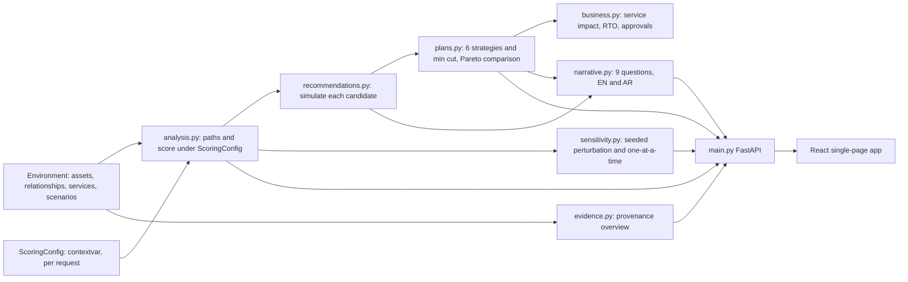

# Architecture

```
React + TS + Vite + Tailwind + React Flow  ──/api (Vite proxy)──▶  FastAPI
  i18n (EN/AR, RTL)                                                ├─ security.py   body limit, rate limit, token/loopback guard
  Dashboard · Graph · Simulation ·                                 ├─ main.py       routes, CORS, error handling
  Recommendations · Environment                                    ├─ state.py      current env + cached analysis + undo history
                                                                   ├─ store.py      SQLite: activity, simulations, explanations, env
                                                                   ├─ models.py     Pydantic domain + whole-graph validation
                                                                   ├─ analysis.py   pruned path search + scoring
                                                                   ├─ simulation.py isolated what-if engine
                                                                   ├─ recommendations.py  simulated + ranked actions
                                                                   └─ explain.py    template text + optional LLM narration
```

## Principles
1. **Deterministic first.** Paths, scores, simulation and recommendations come only from `analysis.py` / `simulation.py`. Nothing is learned, sampled or time-dependent (budgets are step counts, not wall-clock, so results are reproducible).
2. **Evidence, calculation and narration are separate.** `/api/explain` returns `evidence`, `template_explanation` and `ai_explanation` (nullable) as distinct fields; the UI renders the AI part in its own labelled block.
3. **Isolation by construction.** `apply_actions` builds a new relationship list and clones a relationship object only when an action changes it (copy-on-write); objects of the live environment are never mutated. Tests assert this for every action; deliberately breaking it (mutating shared objects, or removing the copy entirely) makes the isolation tests fail, which was verified by hand.
4. **Nothing is executed.** No code path touches infrastructure. Recommendations carry `requires_human_approval: true`.
5. **Fail visibly.** When a safety cap truncates results, `summary.paths_truncated` / `meta.recommendations_partial` are set and the UI shows a warning.

## Environment lifecycle
`AppState` holds the current `Environment`, its analysis and recommendations. Any edit (import, asset/relationship CRUD, reset) builds the candidate environment, validates the **whole** graph (unique ids, no dangling references, no self-loops, one relationship per ordered pair, control rules, known control references) and only then commits it, re-analyses, persists it to SQLite and logs the event. A rejected change leaves state untouched. The previous environment is pushed on an in-memory undo stack (20 deep).

## Path search and scoring
Attack paths: all simple paths from compromised assets to sensitive targets (criticality ≥ 4, server/database/cloud), at most **6 hops**. The search is a DFS **pruned by reverse reachability** (a branch is entered only if the target is still reachable within the remaining hops), so cost tracks output size instead of dead ends. Caps: **500 paths** (global) and **400,000 edge expansions**; hitting either sets `paths_truncated`. A property test compares results to NetworkX's reference `all_simple_paths` on 40 random graphs and the demo.

`score = 100 × (criticality/5) × ease × length_factor × exposure_factor` (heuristic index, not a probability)
- edge weight = evidence (validated 1.0, inferred 0.7, theoretical 0.4) × privilege (none/admin 1.0, write 0.85, read 0.7) × MFA (0.35 when enforced); disabled relationships are not traversable
- `ease` = geometric mean of edge weights; `length_factor` = 1/(1+0.1·(hops−1)); `exposure_factor` = 1.1 if the path crosses an internet-exposed asset
- bands: ≥70 critical, ≥50 high, ≥30 medium, else low; path class = weakest evidence on the path
- **posture index** = mean of the worst path score per *scored* sensitive asset. Sensitive assets that are themselves marked compromised are excluded from targets and from this mean and are reported separately (`summary.compromised_sensitive_assets`): otherwise they would score 0 and make the posture look better as more assets are breached (audit finding F1).
- Operational impact: `high` if a business-critical relationship is touched, `medium` if it has a recorded use, else `low`. MFA is rated one level lower (access remains); **privilege reduction is not** (whether the lower privilege still supports the business function is unknowable; audit finding F3).
- Output ordering is independent of input ordering (audit finding F2), except when a cap truncates the search.
- Validation evidence for all of the above: `docs/TECHNICAL_VALIDATION.md`.

## Simulation
Actions: `remove_relationship`, `disable_relationship` (kept in the data, flagged, reversible), `reduce_privilege` (admin/write → read), `apply_mfa`, `apply_segmentation`. Result: before/after summaries, eliminated/mitigated/remaining paths, residual risks, and `operational_impact`: level (high if a business-critical edge is touched, medium if it has a recorded legitimate use, else low), `affected_relationships` (with legitimate use and reversibility), exact `affected_assets`, `lost_access` (identities whose transitive reach shrank) and `fully_reversible`.

## Recommendations
Candidates are the actions touching edges on attack paths, ordered by how many paths each edge is on; at most **150** are simulated for environments up to 200 relationships and **60** above that (`recommendations_partial` is set when the cap cuts the list). `priority = score_reduction / (1 + disruption_cost)`; cost = 3 per business-critical edge, 1 per edge with legitimate use (×0.75 when reversible — a documented assumption), + 0.5 per lost-access pair.

## Persistence (SQLite, standard library)
Tables: `activity`, `simulations` (actions, environment hash, full result), `explanations` (evidence, template text, AI text/status), `kv` (current environment). Parameterised SQL only; retention caps (2000 / 200 / 500 rows). A simulation record keeps the environment hash so the UI can warn that an old run describes an older environment.

## Scaling (measured, `scripts/benchmark.py`, random sparse/dense graphs, one machine)
| assets / relationships | paths | analyze | recommendations |
|---|---|---|---|
| 15 / 20 | 4 | <1 ms | <0.01 s |
| 200 / 400 | 10 | 2 ms | 0.18 s |
| 100 / 1500 | 500 (cap) | 14 ms | 1.3 s |
| 300 / 3000 | 500 (cap) | 31 ms | 3.8 s |
| 500 / 5000 (validator maximum) | 500 (cap) | 72 ms | 8.1 s |

Before this hardening a 300/3000 environment took 116 s for recommendations and the maximum size did not finish in 150 s (exponential dead-end search); that was fixed by the pruned search, candidate cap and copy-on-write.
The 1 MB request-body limit means the very largest environments cannot be uploaded via the API anyway.

## Frontend
State is lifted in `App.tsx`; after any environment change everything is reloaded and stale simulation state is dropped. All strings live in `messages.ts` (a test enforces EN/AR key parity; activity kinds without a translation fall back to a generic label, never a raw key).

### Design system (`index.css`, `ui.tsx`, `icons.tsx`, `RouteTrace.tsx`)
- **Tokens** (Tailwind `@theme`): surfaces `abyss → surface → raised → lift`, hairline borders, text `cloud / mist / faint`, teal as the only brand accent, severity `crit / high / med / low` (red, amber, gold, green). Each severity also has a lighter `-fg` tint used for *text* on tinted backgrounds, which is what keeps axe's colour-contrast rule green.
- **Typography**: IBM Plex Sans + IBM Plex Sans Arabic + Plex Mono via `@fontsource` (self-hosted; only the subsets a page needs are fetched). Arabic overrides Tailwind's `text-*` line-heights through their CSS variables and uses no letter-spacing (it breaks Arabic joining).
- **Primitives**: `Panel`, `Button` (primary / ghost / danger / quiet; 44 px tall on phones), `SeverityBadge`, `ImpactBadge`, `EvidenceTag` (stroke sample + label), `StackedBar`, `Pips`, `Field` / `Check` (labelled, with `aria-describedby` errors), and `Dialog` (native `<dialog>`: focus trap and Escape for free; focus is restored to the opener explicitly because React unmounts the node first).
- **Route trace**: one component, three uses (dashboard hero, path list, simulation results with a severed hop). Segment stroke encodes evidence; start/target markers encode role; it uses logical CSS properties so it mirrors in RTL with no special cases.
- **Bidi rules**: scores such as `77.1 / 100`, run numbers and ids are wrapped in `<bdi dir="ltr">`; arrows come from the i18n context (`→` or `←`); icons that imply direction mirror via `rtl:` variants; numbers are Latin digits in both languages.
- **Layout**: top navigation on desktop, a fixed bottom bar with sized columns on phones (the header has no backdrop-filter because that would make `position: fixed` children header-relative).

### Attack graph
Custom node cards (glyph, name, type, criticality pips) with handles on the correct sides for LTR, RTL and vertical layouts, orthogonal (`smoothstep`) edges, and edge stroke encoding evidence (solid / dashed / dotted). The layout is a BFS-layered grid, mirrored for RTL. Choosing a path **isolates** it by default as a vertical column and frames it with `fitBounds` computed from our own layout (React Flow's `fitView({nodes})` is ignored on first render, which silently left the graph at default zoom: found by measuring rendered label size, now asserted ≥ 13 px on desktop and ≥ 11 px on phones). Unchecking "Show only selected path" shows the whole graph for context. The page keeps scrolling with the pointer over the graph (`zoomOnScroll` off). Selection works from mouse and keyboard because it is driven by React Flow change events, and all of React Flow's screen-reader strings are localised.

## Decision-intelligence layer (added in the advanced-intelligence sprint)



- **Scoring configuration** (`ScoringConfig`, frozen and hashable). Eight weights with ordering constraints (`theoretical <= inferred <= observed <= 1`, `read <= write <= 1`); `validated`, `admin` and `none` are fixed anchors at 1. The active configuration is a `ContextVar`, so concurrent requests with different weights cannot interfere (tested with threads). The stored configuration is persisted in SQLite and applied to every analysis, recommendation, simulation and plan. The set of attack paths never depends on the weights.
- **Evidence classes** `validated > observed > inferred > theoretical`; a path takes its weakest hop's class. Provenance per relationship: `evidence_source`, `collected_at`, `confidence` (defaults from the class), `validation` (`none` or `synthetic_exercise`; `real_world` is rejected on synthetic data), `rationale`.
- **Business impact** (`business.py`). Services have a criticality and an RTO; relationships say which services they support and how long re-provisioning takes. A change maps to `interrupted` (remove, disable, segment), `degraded` (reduce privilege) or `friction` (MFA). Recovery is `rollback` for reversible actions, the declared `recovery_hours` otherwise, or `unknown` (never silently treated as fine). `business_impact_index` is the criticality-weighted share of affected services (0-100).
- **Plans** (`plans.py`). Strategies: minimal, business-safe, reversible-only, balanced, maximum reduction, and a weighted minimum cut (exact for "least summed removal disruption, then fewest removals"; it ignores the hop limit and reversible actions). Objectives, all minimised: paths left, residual posture, disruption cost, effort. Pareto status is relative to the generated plans. The **suggested starting point** is the lowest residual posture among Pareto plans that are not high-impact and interrupt no critical service; if none qualifies, nothing is suggested. No global-optimality claim is made, and "eliminate every path" is never chosen automatically.
- **Sensitivity** (`sensitivity.py`). Seeded joint perturbation (default 16 trials, +-30%) and a one-at-a-time sweep: score ranges, rank ranges, recommendation stability (`stable` if in the top 3 in at least 90% of trials, `moderate` at least 60%, else `sensitive`), and which assumption moves the posture most. These are not confidence intervals.
- **Explanations** (`narrative.py`). Nine questions answered in English and Arabic from engine numbers only. Confidence is a heuristic label (never `high` without a sensitivity run) and is explicitly not a probability.

### Architectural decisions

| Decision | Reason |
|---|---|
| Weights in a context-local config, not module globals | Module globals could not be changed per request safely; sensitivity runs and the UI both need different weights concurrently. |
| `observed` as a fourth class between inferred and validated | Separates "seen in a data source" from "independently confirmed" without calling the former validation. |
| Demo mode computes but never persists | Anonymous visitors must not be able to grow the audit database or trigger AI calls. |
| Plans and sensitivity computed outside the state lock on an immutable snapshot | Heavy requests do not block reads; results are cached only if the state is unchanged. |
| Min-cut edges inserted in id order | The chosen cut does not depend on input ordering (tested). |
| Single image serves API and SPA | One origin: no CORS and one URL to verify. |

## API reference (all paths under `/api`)

| Method and path | Purpose | Public demo, visitor |
|---|---|---|
| `GET /health`, `/ready`, `/auth/status`, `/auth/whoami` | Liveness, readiness, mode, whether this caller can write | yes |
| `GET /environment`, `/environment/meta`, `/analysis`, `/recommendations` | Current model, hash and flags, paths and scores, ranked actions | yes |
| `GET /plans`, `/plans/{id}/report?lang=en` or `ar` | Plan comparison with Pareto flags; Markdown decision record | yes (no audit row) |
| `GET /recommendations/{id}/explanation` | Nine answers, both languages, confidence label | yes |
| `GET /sensitivity?trials&spread&seed` | Sensitivity analysis (visitors get the cached default run only) | yes |
| `GET /scoring-config` | Current and default weights | yes |
| `GET /evidence`, `/services`, `/attack-scenarios`, `/activity`, `/simulations`, `/explanations`, `/ai/status` | Provenance overview, service dependencies, scenarios, audit and history | yes |
| `POST /simulate`, `POST /explain` | Isolated what-if; template (and optional AI) explanation | yes, **not persisted**, AI off |
| `PUT /scoring-config`, `POST /scoring-config/reset` | Change or reset the weights | admin only |
| `PUT /environment`, `POST /environment/reset`, `POST /environment/undo` | Import, reset, undo | admin only |
| `POST /attack-scenarios/{id}/activate` | Switch the assumed-breach starting points (undoable) | admin only |
| `POST`, `PUT`, `DELETE` on `/assets`, `/relationships` | Edit the model (whole graph re-validated, atomic) | admin only |

Errors: `422` validation (list of `{loc, msg}`), `403 read_only_demo | invalid_admin_token | local_only`, `401 invalid_or_missing_token`, `413`, `411`, `429` with `Retry-After`, `500 internal_error` (no internals).

## Environment variable reference

| Variable | Default | Meaning |
|---|---|---|
| `ATHAR_MODE` | `local` | `local` or `demo` (any other value means `local`). |
| `ATHAR_API_TOKEN` | unset | Local mode: if set, required (`X-ATHAR-Token`) for every `/api` call except health, readiness and auth status. At least 16 characters. |
| `ATHAR_ADMIN_TOKEN` | unset | Demo mode: enables writes for the holder. At least 16 characters, different from `ATHAR_API_TOKEN`. |
| `ATHAR_CORS_ORIGINS` | local mode: `http://localhost:5173,http://127.0.0.1:5173`; demo mode: empty (same-origin only) | Allowed cross-origin browser origins (no wildcards, http or https only). |
| `ATHAR_CSP_CONNECT` | empty | Extra https origins in the CSP `connect-src` (split deployments). |
| `ATHAR_TRUST_PROXY` | `0` | `1` only behind exactly one trusted proxy: use the right-most `X-Forwarded-For` entry and `X-Forwarded-Proto`. |
| `ATHAR_HSTS` | `0` | `1` forces the `Strict-Transport-Security` header. |
| `ATHAR_FORCE_HTTPS` | `0` | `1` (with `ATHAR_TRUST_PROXY=1`): redirect requests the proxy reports as plain http to https (308). Probes `/api/health` and `/api/ready` are exempt. |
| `ATHAR_FRAME_ANCESTORS` | empty (nobody) | Space separated https origins that may embed the app (CSP `frame-ancestors`; `X-Frame-Options` is then omitted). A bare `*`, `http://` and malformed values are ignored. Used by the Hugging Face Space. |
| `ATHAR_STATIC_DIR` | `frontend/dist` if present | Directory of the built single-page app to serve. |
| `ATHAR_DB` | `backend/data/athar.db` | SQLite file (`:memory:` allowed). |
| `ATHAR_DOCS` | `0` | `1` re-enables `/docs` and `/openapi.json` in demo mode (always on in local mode). |
| `ATHAR_LOG_LEVEL` | `INFO` | JSON log level. |
| `ATHAR_RATE_READ`, `ATHAR_RATE_WRITE`, `ATHAR_RATE_EXPLAIN` | 300, 90, 40 | Requests per minute per client; the third bucket covers explain, plans, sensitivity and reports. |
| `ATHAR_MAX_BODY` | 1048576 | Maximum request body in bytes. |
| `ATHAR_AI_PROVIDER`, `ANTHROPIC_API_KEY`, `ATHAR_AI_MODEL` | unset | Optional AI narration (off by default; never used for visitors of the public demo). |
| `VITE_API_BASE` (frontend build) | empty | Public API origin for a split deployment. Compiled into the bundle: never a secret. |
